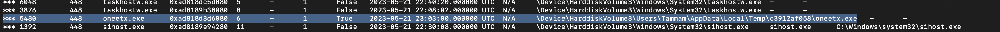
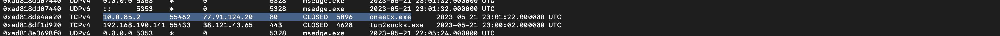
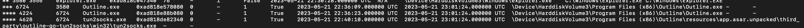
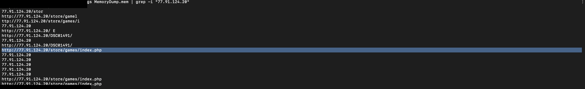

# RedLine — Infostealer Memory Analysis

| | |
|---|---|
| **Platform** | CyberDefenders |
| **Category** | Endpoint Forensics (Memory) |
| **Tools** | Volatility 3, strings |
| **ATT&CK** | T1055 (Process Injection), T1218.011 (Rundll32), T1071.001 (Web C2), T1090 (Proxy) |

## Overview

A compromised system was captured to a memory image (`MemoryDump.mem`) for analysis. The objective is to identify the malicious process, name the malware family, determine how the attacker bypassed the network IDS, and extract the C2 infrastructure, using Volatility 3 and `strings`. The analysis anchors on identifying a single anomalous process, from which the remaining indicators follow.

## Methodology

### 1. Identify the anomalous process

`windows.pstree` presents the process hierarchy. One entry is anomalous: `oneetx.exe` executing from `C:\Users\Tammam\AppData\Local\Temp\c3912af058\` with `svchost.exe` as its parent. Execution from a temporary subdirectory and an irregular parent-child relationship (svchost.exe does not normally parent user executables) identify this as the RedLine stealer and the anchor for the investigation.



### 2. Identify the child process

The same process tree shows `oneetx.exe` spawning `rundll32.exe`, a signed Windows binary abused to execute DLL payloads under a trusted process name (system-binary proxy execution). A stealer in a temporary directory launching rundll32 is a characteristic payload-execution pattern.

### 3. Confirm process injection

`windows.vadinfo --pid <oneetx-pid>` enumerates the process's memory regions. The presence of a `PAGE_EXECUTE_READWRITE` region, memory that is both writable and executable, is the signature of code injection, since legitimate code is typically execute-only or read-only. Writable-and-executable memory is where injected shellcode resides.

### 4. Separate malicious C2 from legitimate tooling

`windows.netscan` maps network connections to processes, and two external addresses are present. `oneetx.exe` connects to `77.91.124.20:55462` (TCP), which is the C2. The second address, `38.121.43.65:443`, belongs to `tun2socks.exe` under `Outline.exe`, a legitimate Outline VPN tunnel. The key finding of the case is here: the attacker used the VPN to tunnel traffic and bypass the network IDS, so the analysis must distinguish malicious C2 from attacker-used but otherwise legitimate tooling rather than flag both.





### 5. Recover the full C2 URL

An IP and port do not provide the full C2 picture. Running `strings` over the image and filtering for the C2 IP recovers the complete callback URL, `http://77.91.124.20/store/games/index.php`, which is the HTTP C2 endpoint available for blocking and proxy-log hunting.



## Volatility 3 commands used

```
vol -f MemoryDump.mem windows.pstree
vol -f MemoryDump.mem windows.vadinfo --pid <oneetx-pid> | grep PAGE_EXECUTE_READWRITE
vol -f MemoryDump.mem windows.netscan
strings MemoryDump.mem | grep -i "77.91.124.20"
```

## Key findings

| Type | Value | Context |
|---|---|---|
| Malicious process | `oneetx.exe` (parent `svchost.exe`) | RedLine stealer, run from Temp |
| Full path | `C:\Users\Tammam\AppData\Local\Temp\c3912af058\oneetx.exe` | non-standard exec location |
| Child process | `rundll32.exe` | DLL / payload execution |
| Memory protection | `PAGE_EXECUTE_READWRITE` | code-injection / shellcode region |
| C2 IP | `77.91.124.20:55462` (TCP) | attacker server (via oneetx.exe) |
| C2 URL | `http://77.91.124.20/store/games/index.php` | recovered from strings |
| VPN (benign) | `outline.exe` → `tun2socks.exe` → `38.121.43.65:443` | Outline VPN, NIDS bypass |

## MITRE ATT&CK mapping

| Tactic | Technique | ID | Evidence |
|---|---|---|---|
| Defense Evasion / Priv Esc | Process Injection | T1055 | `PAGE_EXECUTE_READWRITE` region in oneetx.exe |
| Defense Evasion | System Binary Proxy Execution: Rundll32 | T1218.011 | `rundll32.exe` child of oneetx.exe |
| Command and Control | Application Layer Protocol: Web Protocols | T1071.001 | HTTP C2 to `http://77.91.124.20/store/games/index.php` |
| Command and Control | Proxy | T1090 | `outline.exe` / `tun2socks.exe` tunnel used to bypass the NIDS |

## Analysis notes and detection

- The case anchors on a single anomalous process: `oneetx.exe` in a Temp directory parented by `svchost.exe`. The child process, injected memory region, C2, and full path all derive from it.
- Two external addresses carried different meanings. `77.91.124.20` was the C2; `38.121.43.65:443` was a legitimate Outline VPN the attacker used to bypass the NIDS. Separating the two is the central analytical skill in this case.
- `PAGE_EXECUTE_READWRITE` is the process-injection signature, marking writable and executable memory.
- **Detection:** alert on executables launched from `AppData\Local\Temp\*` parented by `svchost.exe`; on `rundll32.exe` spawned by a temp-directory process; on RWX memory allocations; and on the presence of `tun2socks` or `outline` where VPN tooling is not expected, a NIDS-evasion indicator.

<!-- Retired lab. Paths/IPs are lab artifacts. -->
