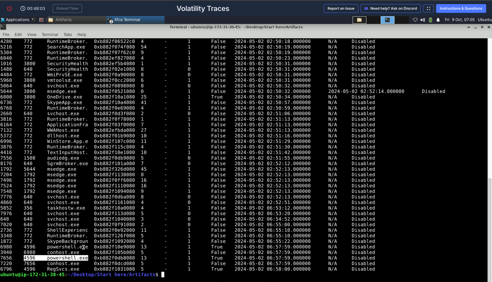
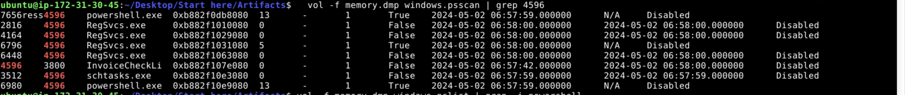
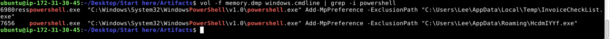
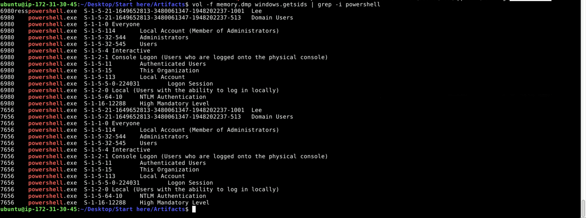
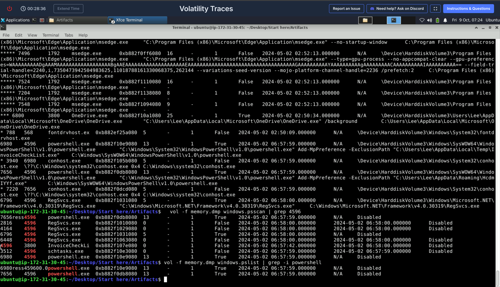

# Volatility Traces — PowerShell Malware in Memory

| | |
|---|---|
| **Platform** | CyberDefenders |
| **Category** | Endpoint Forensics (Memory) |
| **Tools** | Volatility 3 (v2.7.0+) |
| **ATT&CK** | T1564 (Hide Artifacts), T1053.005 (Scheduled Task), T1059.001 (PowerShell) |

## Overview

Suspicious PowerShell activity was observed on critical systems on 2 May 2024, and a memory image (`memory.dmp`) was captured for analysis. The investigation uses Volatility 3 to trace the malware's execution, persistence, and evasion. The analysis proceeds as a chain of plugins, each result identifying the next pivot.

## Methodology

### 1. Enumerate active processes

`windows.pslist` lists processes present in the live process list. Two `powershell.exe` instances (PIDs 6980 and 7656) share the same parent, PID 4596. A single uncommon parent spawning multiple PowerShell instances is the initial lead.



### 2. Recover the hidden parent process

PID 4596 does not appear in `pslist`, which indicates the parent process has terminated. This motivates the core memory-forensics technique: `windows.psscan` scans raw memory structures and recovers terminated or unlinked processes that `pslist` cannot show. `psscan` surfaces PID 4596 as `InvoiceCheckLi`, truncated to 16 characters by the kernel's EPROCESS name field. Both `pslist` and `psscan` are run because they answer different questions.

### 3. Recover the full name and intent

`windows.cmdline` returns the full executable name `InvoiceCheckList.exe` and the associated PowerShell command line. The command line shows active Defender abuse: `Add-MpPreference -ExclusionPath` adding scan exclusions for `InvoiceCheckList.exe` and `HcdmIYYf.exe`. Adding Defender exclusions for executables in a user-writable path is a strong indicator of malicious intent.





### 4. Identify persistence and additional children

Filtering `psscan` on PPID 4596 reveals the remaining children: `schtasks.exe` (PID 3512), responsible for scheduled-task persistence, and `RegSvcs.exe`, a .NET utility commonly abused for process hollowing by stealers.

### 5. Attribute the activity to an account

`windows.getsids` ties the malicious processes to the user SID `S-1-5-21-1649652813-3480061347-1948202237-1001` (user `Lee`), establishing the security context under which the malware ran.





## Volatility 3 commands used

```
vol -f memory.dmp windows.pslist
vol -f memory.dmp windows.psscan | grep 4596
vol -f memory.dmp windows.cmdline | grep -i invoicecheckli
vol -f memory.dmp windows.cmdline | grep -i powershell
vol -f memory.dmp windows.getsids | grep -i powershell
```

## Key findings

| Type | Value | Context |
|---|---|---|
| Malicious parent | `InvoiceCheckList.exe` (PID 4596, PPID 3800) | spawned the malicious tree |
| Child processes | `powershell.exe` (6980, 7656), `schtasks.exe` (3512), `RegSvcs.exe` | post-exec activity |
| Persistence | `schtasks.exe` | scheduled task creation |
| Evasion cmdlet | `Add-MpPreference -ExclusionPath` | Defender scan exclusions |
| Excluded files | `InvoiceCheckList.exe`, `HcdmIYYf.exe` | hidden from AV |
| Account | SID `S-1-5-21-1649652813-3480061347-1948202237-1001` (user `Lee`) | ran the malicious PowerShell |

## MITRE ATT&CK mapping

| Tactic | Technique | ID | Evidence |
|---|---|---|---|
| Execution | Command and Scripting Interpreter: PowerShell | T1059.001 | malicious PowerShell children |
| Persistence | Scheduled Task/Job: Scheduled Task | T1053.005 | `schtasks.exe` child |
| Defense Evasion | Hide Artifacts (Defender exclusions) | T1564.012 | `Add-MpPreference -ExclusionPath` |

> The lab's accepted mapping for the Defender-exclusion step is T1564.012. In practice this activity is also commonly mapped to T1562.001 (Impair Defenses: Disable or Modify Tools). The distinction is between hiding artifacts from AV (T1564.012) and impairing the AV itself (T1562.001), and is worth noting in an interview.

## Analysis notes and detection

- The distinction between `pslist` and `psscan` is central to the case. The malicious parent had terminated and was invisible to `pslist`, but recoverable with `psscan`, which reads raw memory structures. Both should always be run.
- The kernel truncates process names to 16 characters, so `InvoiceCheckLi` required `cmdline` to recover the full `InvoiceCheckList.exe`; `cmdline` also exposed the intent.
- `Add-MpPreference -ExclusionPath` targeting a temp-directory executable is a reliable evasion indicator.
- **Detection:** alert on `Add-MpPreference -ExclusionPath` targeting user-writable paths (Temp, AppData); on `schtasks /create` from a non-administrative parent; and on `RegSvcs.exe` spawned by a non-.NET-build parent, a common process-hollowing pattern for stealers.

<!-- Retired lab. Account name/SID are lab artifacts. -->
